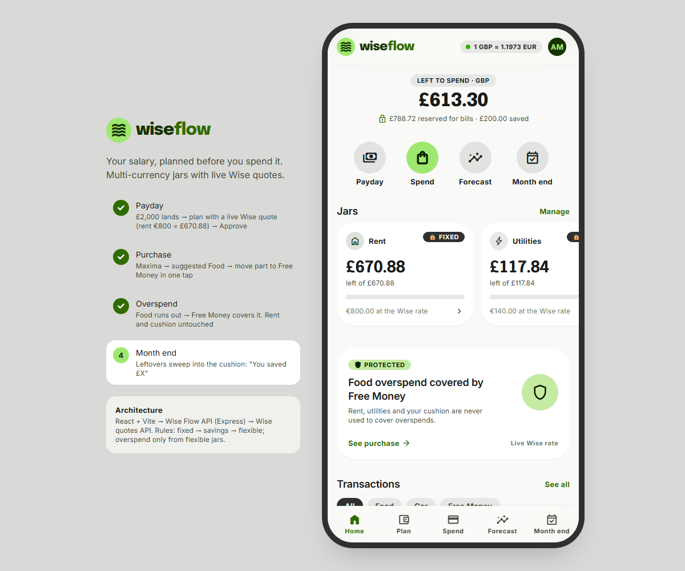
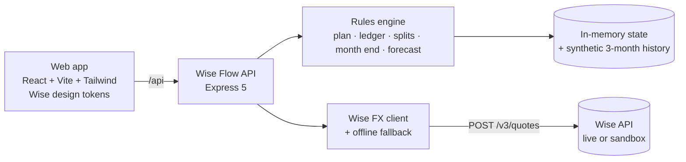

# Wise Flow: payday planner (proof of concept)

> Your salary lands in one lump and you only find out you overspent after the purchase.
> **Wise Flow** splits the salary into protected jars the moment it lands: bills first (converted at the
> live Wise rate), savings next, flexible budgets last. Then it keeps the jars honest as you spend.



Mobile web app in the Wise design language + a small API with a rules engine and real Wise FX quotes.

## Demo in 4 scenes

| # | Scene | What to show |
|---|-------|--------------|
| 1 | **Payday** | £2,000 lands → **Plan** builds a draft with a live Wise quote (*rent €800 = £X*) → **Approve plan** |
| 2 | **Purchase** | **Spend** → *Weekly shop at Maxima* (€42.30) → suggested **Food** → tap **£10** to move part of it to **Free Money** |
| 3 | **Overspend** | *Party shop that blows the Food jar* → Free Money covers the gap. 🔒 Rent and 🛡 cushion are never touched |
| 4 | **Month end** | **Month end** → *Close month* → "You saved £X": flexible leftovers move into the cushion |

On a laptop screen a presenter panel next to the phone tracks the four scenes. Reset any time from the avatar menu
(**Reset demo**) or with `POST /api/demo/reset`.

## Quick start

Requirements: [Node.js](https://nodejs.org) 20.19+ (LTS recommended).

```bash
npm install
npm run dev          # API on :8787 + web app on :5173 → open http://localhost:5173
```

Single process, production-like (also the offline backup for the demo):

```bash
npm run build
npm start            # API + built web app on http://localhost:8787
```

```bash
npm test             # engine, Wise client and API tests (Vitest)
npm run typecheck
```

Optional settings live in `.env` (see [`.env.example`](.env.example)).

## Wise integration

| Mode | When | Endpoint |
|------|------|----------|
| **Live public quotes** (default) | no token | `POST https://api.wise.com/v3/quotes`: real Wise rate and fee, cannot be used for a transfer |
| **Sandbox** | `WISE_API_TOKEN` set | `POST https://api.wise-sandbox.com/v3/profiles/{id}/quotes` (sandbox rates are realistic, not live) |
| **Offline fallback** | Wise unreachable, or `FX_MODE=offline` | last live Wise rate (or an approximate rate); the UI shows *Offline rate* |

Every fixed bill in EUR (rent €800, utilities €140) gets its own quote, so the plan shows exactly what the bill costs in
GBP with the Wise fee included. Card payments in EUR are converted at the plan's Wise rate. Check the integration directly:
`GET /api/fx/quote?source=GBP&target=EUR&targetAmount=800`.

## Architecture



### Rules

- **Payday**: fixed bills → savings (10% of salary by default) → flexible jars (Food, Car from the forecast) → the rest
  is **Free Money**. The plan always adds up to the salary. If the salary is below the bills, bills are funded in order
  and everything else stays empty, with a warning.
- **Nothing moves without approval**: `POST /payday` only drafts a plan; `POST /plan/approve` creates the jars.
- **Overspend**: covered from **Free Money first**, then from other flexible jars. **Never** from fixed bills or the
  cushion; anything left is reported as *uncovered*.
- **Moving a purchase**: only between flexible jars, and the parts must add up to the purchase.
- **Month end**: leftovers of flexible jars are swept into the cushion; fixed bills stay reserved.
- **Forecast**: 3-month moving average + 5%, rounded to £5 (*"usually £273 → plan £285"*).

## API

Base URL `/api`. Contract types: [`shared/types.ts`](shared/types.ts).

| Method | Path | Body | Result |
|--------|------|------|--------|
| POST | `/payday` | `{ amount, currency, savingsRate?, overrides?, refreshQuotes? }` | draft `Plan` |
| POST | `/plan/approve` | | active `Plan` (jars created) |
| GET | `/categories` | | `Category[]` with balances |
| POST | `/purchases` | `{ merchant, amount, currency?, categoryId? }` | `{ purchase, categories }` with the suggested jar |
| POST | `/purchases/:id/split` | `{ splits: [{ categoryId, amount }] }` | `{ purchase, categories }` |
| POST | `/month-end` | | `MonthEndResult` (`saved`, cushion before/after) |
| GET | `/forecast` | | per-jar forecast from history |
| GET | `/state` | | everything the UI needs in one call |
| GET | `/plan`, `/purchases`, `/merchants`, `/fx/quote`, `/health` | | helpers |
| POST | `/demo/reset` | | fresh demo state |

```text
Category { id, name, type: fixed|flexible|savings, currency, allocated, spent, remaining, coveredIn, coveredOut, ... }
Plan     { salary, currency, categories[], fxQuotes[], warnings[], status, month, ... }
Purchase { id, merchant, amount, currency, suggestedCategoryId, splits[{ categoryId, amount }], coverage[], ... }
```

Example:

```bash
curl -X POST localhost:8787/api/payday -H "Content-Type: application/json" -d '{"amount":2000,"currency":"GBP"}'
curl -X POST localhost:8787/api/plan/approve
curl -X POST localhost:8787/api/purchases -H "Content-Type: application/json" -d '{"merchant":"Maxima","amount":42.3,"currency":"EUR"}'
```

## Project structure

```text
shared/types.ts           API contract shared by server and web
server/src/engine/        rules: plan.ts, ledger.ts (overspend), splits.ts, monthEnd.ts, forecast.ts
server/src/wise/fx.ts     Wise quotes (public / sandbox) + offline fallback
server/src/data/          synthetic history generator, merchant → jar directory
server/src/service.ts     state machine: payday → approve → purchases → month end
server/src/app.ts         Express routes (also serves web/dist)
server/test/              Vitest: engine, Wise client, API flow
web/src/screens/          Home, Plan (payday, approval, jars), Spend, Forecast, Month end
web/tailwind.config.js    Wise-style design tokens (colours, Epilogue/Inter type scale, radii)
```

## Deploy

- **Docker**: `docker build -t wise-flow . && docker run -p 8787:8787 wise-flow`
- **Render**: [`render.yaml`](render.yaml) blueprint (New → Blueprint → this repo). Add `WISE_API_TOKEN` there if needed.
- **Any Node host**: `npm ci --include=dev && npm run build && npm start` (honours `PORT`).

State is in memory: one demo user, reset on restart.

## Honest notes

- **Synthetic data**: the persona (paid in GBP, living in the Baltics), salary, merchants and the 3-month history are generated.
  No real money moves and no Wise account is touched.
- **FX quotes are real**: live Wise prices from the public quote API, unless the UI says *Offline rate*.
- Not built yet: Wise Jars via API, card limits per jar, real transaction history, salaries in other currencies.

## What's next

- One Wise Jar per category and **card spending limits per jar**, so overspend protection happens at the card.
- Real transaction history from Wise for the forecast and merchant suggestions.
- Multi-currency salaries and jars held in the bill's currency.

## AI usage disclosure

This proof of concept was built with AI assistance: GitHub Copilot (coding agent) generated the code, tests and docs from
the team's 10-hour plan and the Wise-style design mock. The team reviews, runs and owns every change.

## Команде

| Роль | Где код |
|------|---------|
| P1 Движок | `server/src/engine/*`, тесты `server/test/engine.test.ts` |
| P2 Wise и инфраструктура | `server/src/wise/fx.ts`, `.env.example`, `Dockerfile`, `render.yaml` |
| P3 Фронтенд «План» | `web/src/screens/PlanScreen.tsx`, `HomeScreen.tsx` |
| P4 Фронтенд «Траты» | `web/src/screens/SpendScreen.tsx`, `MonthEndScreen.tsx`, `components/PurchaseSheet.tsx` |
| P5 Данные и питч | `server/src/data/*`, `web/src/screens/InsightsScreen.tsx`, сценарий демо выше |

Контракт API — `shared/types.ts`: меняйте его первым, затем сервер и фронтенд.
